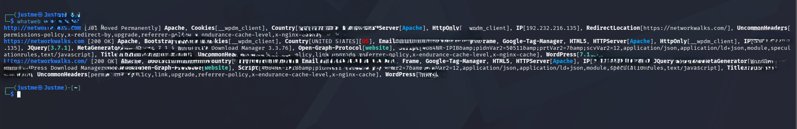

# 🔍 Reconnaissance Toolkit: Kali Linux Pen Testing Project

A hands-on reconnaissance (information gathering) project for the first phase of a penetration test, using built-in Kali Linux tools plus Windows utilities for cross-platform verification.

> ⚠️ **Legal Disclaimer:** This project is for **educational purposes and authorized security testing only**. Only run these tools against domains you own or have **written permission** to test. Unauthorized scanning may be illegal in your jurisdiction. The author accepts no responsibility for misuse.

---

## 📌 Project Overview

Reconnaissance is the foundation of every penetration test. This project documents a structured workflow for collecting information about a target domain using **passive** (no direct contact) and **active** (direct contact) techniques, and includes a Bash script to automate the process and save organized output.

**Objectives**
- Identify domain ownership and registration details
- Discover the IP address, DNS records, and name servers
- Fingerprint the web server, CMS, and technologies in use
- Detect whether a Web Application Firewall (WAF) is present
- Harvest emails, subdomains, and hosts from public sources
- Identify live hosts using Nmap host discovery (ping sweep)

---

## 🧰 Tools Used

| Tool | Purpose |
|------|---------|
| **Kali Linux & Windows** | Operating systems used for reconnaissance activities |
| **WHOIS** | Find domain registration details (owner, dates, name servers) |
| **whatweb** | Fingerprint web technologies (server, CMS, plugins, IP) |
| **nslookup** | Resolve the domain name to its IP address using DNS |
| **curl -I** | Read the HTTP response headers of the website |
| **wafw00f** | Detect whether a Web Application Firewall protects the site |
| **dnsrecon** | Enumerate all DNS records (NS, MX, SPF, TXT, SRV) |
| **theHarvester** | Collect emails, subdomains, IPs, and hosts from dozens of public sources |
| **Nmap** | Host discovery: determine which hosts are online without scanning ports |

---

## 🗂️ Repository Structure

```
recon-toolkit/
├── README.md              # Project documentation (this file)
├── recon.sh               # Automated recon script
├── docs/
│   └── methodology.md     # Workflow and analysis notes
├── reports/
│   ├── recon-findings.md  # Completed findings report
│   └── report-template.md # Blank findings report template
├── screenshots/           # Terminal evidence for each tool
├── output/                # Scan results are saved here (git-ignored)
├── .gitignore
└── LICENSE
```

---

## ⚙️ Setup

### Kali Linux
Most tools come pre-installed. Verify or install any that are missing:

```bash
sudo apt update
sudo apt install -y whois whatweb curl dnsutils wafw00f dnsrecon theharvester nmap
```

### Windows
`nslookup` and `curl.exe` are built into Windows 10/11 and are used here for cross-platform verification:

```powershell
nslookup networkwalks.com 
curl.exe -I https://networkwalks.com 
```

---

## 🚀 Quick Start (Automated)

```bash
git clone https://github.com/<your-username>/recon-toolkit.git
cd recon-toolkit
chmod +x recon.sh
./recon.sh networkwalks.com 
```

To also run Nmap host discovery across an authorized network range, pass it as a second argument:

```bash
./recon.sh networkwalks.com 10.0.0.10/24
```

Results are saved to `output/<domain>_<timestamp>/`, one file per tool.

---

## 🧪 Manual Walkthrough


### 1. WHOIS: Domain Registration Details
```bash
whois networkwalks.com 
```
**What to look for:** registrar, creation/expiry dates, registrant organization, name servers. (Many domains hide owner details behind privacy protection.)

### 2. nslookup: DNS Resolution
```bash
nslookup networkwalks.com 
```
**What to look for:** the IP address(es) the domain resolves to, and which DNS server answered. Multiple IPs or Cloudflare/Akamai ranges can indicate a CDN.

### 3. curl -I: HTTP Response Headers
```bash
curl -I -L https://networkwalks.com 
```
**What to look for:**
- `Server:` (web server type/version)
- `X-Powered-By:` (backend technology)
- Security headers: `Strict-Transport-Security`, `Content-Security-Policy`, `X-Frame-Options`, `X-Content-Type-Options`
- `Set-Cookie:` flags (`Secure`, `HttpOnly`, `SameSite`)

### 4. whatweb: Technology Fingerprinting
```bash
whatweb -v networkwalks.com 
```
**What to look for:** web server, CMS (WordPress, Joomla, etc.), plugins, JavaScript libraries, IP address, and country.

### 5. wafw00f: WAF Detection
```bash
wafw00f https://networkwalks.com 
```
**What to look for:** whether a WAF (e.g., Cloudflare, AWS WAF, Imperva) is detected. This affects how later testing should be approached.

### 6. dnsrecon: DNS Enumeration
```bash
dnsrecon -d networkwalks.com 
```
**What to look for:** NS, MX, SOA, A/AAAA, SPF and other TXT records, and SRV records. Misconfigured SPF or exposed internal hostnames are common findings.

### 7. theHarvester: OSINT Collection
```bash
theHarvester -d example.com -b duckduckgo,crtsh,rapiddns -l 200
```
**What to look for:** email addresses, subdomains, IPs, and hosts. Some sources require API keys (configure in `/etc/theHarvester/api-keys.yaml` or `~/.theHarvester/api-keys.yaml`).

### 8. Nmap: Host Discovery
```bash
# Single host (the IP or domain from earlier steps)
nmap -sn 10.0.0.10/24

# Ping sweep of an authorized network range
nmap -sn 10.0.0.10/24

# Save results in all formats for the report
nmap -sn 10.0.0.10/24 -oA output/host-discovery
```
`-sn` tells Nmap to perform **host discovery only** and skip the port scan.

**What to look for:**
- Which hosts report as **up**, along with their IP addresses and hostnames
- Latency values and MAC address/vendor (on the local network)
- Hosts that appear down but may simply be filtering probes. If ping is blocked, try alternate probes such as `-PS80,443` (TCP SYN) or `-PA80,443` (TCP ACK), or `-Pn` to skip discovery and treat the host as up.

> Nmap sends packets directly to the target, so run it only against hosts and ranges you are authorized to scan.

---

## 🧠 Passive vs. Active Reconnaissance

| Type | Tools in this project | Touches the target? |
|------|----------------------|---------------------|
| Passive | `whois`, `theHarvester` (public sources), `nslookup`, `dnsrecon` (standard lookups) | No / minimal |
| Active | `curl -I`, `whatweb`, `wafw00f`, `nmap -sn` | Yes, sends requests/probes to the target |

---

## 📸 Screenshots

Evidence from each stage of the reconnaissance (see [`screenshots/`](screenshots/)).

| Tool | Evidence |
|------|----------|
| WHOIS |  |
| nslookup |  |
| curl -I |  |
| whatweb |  |
| wafw00f |  |
| dnsrecon |  |
| theHarvester |  |
| Nmap host discovery |  |

---

## 📊 Findings Summary

| # | Risk / Finding | Evidence / Observation | Potential Impact | Risk Level |
|---|----------------|------------------------|------------------|------------|
| 1 | Web technology information exposed | WhatWeb identified WordPress and WP Download Manager | Attackers may use exposed technology/version information to identify software requiring further security review | 🟠 Medium |
| 2 | Server IP address identifiable | Nslookup resolved the domain to `192.232.216.135` | Provides information about the network location of the web service | 🟡 Low |
| 3 | HTTP technical information exposed | Curl returned HTTP response headers and exposed `/wp-json/` | May assist technology fingerprinting and further enumeration | 🟡 Low |
| 4 | WAF technology identifiable | Wafw00f identified ModSecurity (SpiderLabs) | Reveals information about the web application's security architecture | 🟡 Low |
| 5 | DNS infrastructure information exposed | DNSRecon identified DNS, mail and service-related records | DNS information can help build a broader infrastructure profile | 🟠 Medium |

**Result:** 5 findings: 2 Medium, 3 Low, with no critical or high-risk issues. Full details and recommendations are in [`reports/recon-findings.md`](reports/recon-findings.md). To document your own results, use [`reports/report-template.md`](reports/report-template.md).

---

## 💡 Lessons Learned

**Technical**
- **Small details add up.** The CMS, a plugin name, an IP address, and a WAF type are each minor on their own, but combined they gave a useful profile of the target.
- **Different tools confirm each other.** Comparing the IP from `nslookup` with `whatweb` output, and subdomains from `theHarvester` with `dnsrecon`, helped validate results and catch gaps.
- **A WAF changes the picture.** Detecting ModSecurity with `wafw00f` showed that later testing would need to account for filtering and that direct probing might be logged or blocked.
- **HTTP headers reveal a lot.** `curl -I` was a fast, low-noise way to see server behavior and spot the exposed `/wp-json/` endpoint.
- **Host discovery can miss hosts.** Firewalls often drop ping probes, so a host showing as "down" in `nmap -sn` may still be online. Combining ICMP, TCP SYN, and TCP ACK probes gives more reliable results.
- **OSINT tools depend on their sources.** `theHarvester` results vary by data source, and some sources need API keys, so coverage is never complete.

**Process**
- **Authorization comes first.** Written scope and permission are required before any active scanning.
- **Document as you go.** Saving commands, timestamps, and screenshots at each step made reporting much easier.
- **Rate findings with context.** Information disclosure is usually Low or Medium. Over-rating it weakens a report, and ignoring it misses real attack-surface clues.
- **Automation saves time but needs review.** `recon.sh` standardized the workflow, but results still need manual analysis to be meaningful.

**Challenges**
- Some tools return different amounts of data depending on network conditions, rate limits, and target configuration.
- Privacy-protected WHOIS records limit what can be learned about ownership.
- Active tools (`whatweb`, `wafw00f`, `curl`, `nmap`) touch the target, so they should be run deliberately and within scope.

**Next steps**
- Extend Nmap from host discovery to port and service scanning (`-sV`, `-sC`).
- Add deeper subdomain enumeration with `amass` or `subfinder`.
- Move on to vulnerability assessment, such as `WPScan` for WordPress, once scope allows.
- Automate report generation from the saved output.

---

## 🛡️ Defensive Takeaways

- Enable WHOIS privacy to limit exposed contact data
- Remove or genericize `Server` and `X-Powered-By` headers
- Add security headers (HSTS, CSP, X-Frame-Options)
- Publish strict SPF, DKIM, and DMARC records
- Audit DNS for forgotten or exposed subdomains
- Keep CMS and plugins fully updated
- Deploy a WAF and monitor for scanning activity
- Filter unnecessary ICMP and expose only required hosts and services to the internet
- Log and alert on ping sweeps and other host discovery attempts (IDS/IPS)

---

## 🔮 Future Improvements

- Extend `nmap` from host discovery to port, service, and OS detection scans
- Add `amass` / `subfinder` for deeper subdomain enumeration
- Export results to HTML/PDF reports automatically
- Integrate a Python parser to summarize outputs

---

## 📚 References

- [Kali Linux Tools](https://www.kali.org/tools/)
- [theHarvester](https://github.com/laramies/theHarvester)
- [dnsrecon](https://github.com/darkoperator/dnsrecon)
- [wafw00f](https://github.com/EnableSecurity/wafw00f)
- [WhatWeb](https://github.com/urbanadventurer/WhatWeb)
- [OWASP Web Security Testing Guide](https://owasp.org/www-project-web-security-testing-guide/)

